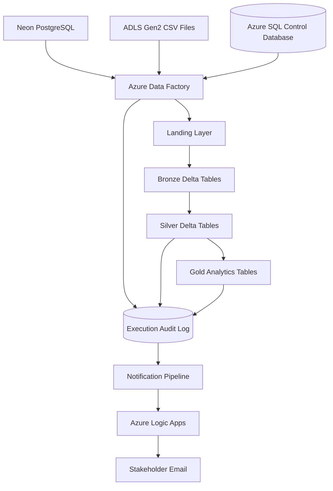
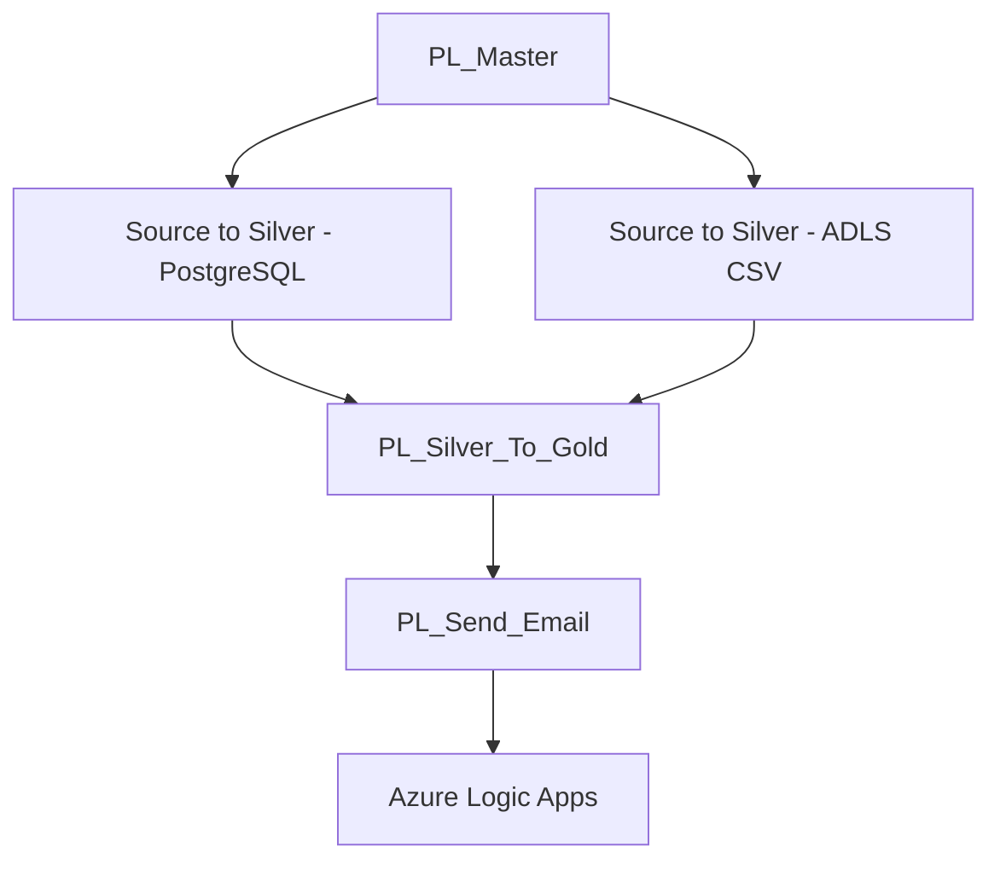

# CareSync | Azure Data Engineering Platform


## Project Overview

CareSync is an end-to-end, metadata-driven Azure data engineering platform designed to integrate, transform, validate, and monitor healthcare data across multiple source systems.

The platform demonstrates how organizations can replace fragmented data integration processes with a centralized, scalable, and observable data architecture.

Rather than developing individual pipelines for every source table, CareSync uses a reusable configuration-driven framework to manage ingestion, incremental processing, transformations, execution tracking, and operational notifications.

## Business Objectives

- Consolidate data from heterogeneous source systems.
- Reduce repetitive pipeline development.
- Support full and incremental data ingestion.
- Maintain consistent and reliable data transformations.
- Provide traceability across pipeline executions.
- Automate operational status reporting.
- Establish trusted datasets for downstream analytics.
- Provide a foundation for future source system integration.

## Solution Architecture



Azure Data Factory provides orchestration, Azure Databricks executes data transformations, and Azure Data Lake Storage Gen2 provides the storage foundation.

Unity Catalog provides centralized organization and governance of the Delta tables.

## Technology Stack

| Technology | Responsibility |
|---|---|
| Azure Data Factory | Pipeline orchestration and source ingestion |
| Azure Databricks | Distributed data processing and transformations |
| ADLS Gen2 | Landing and data lake storage |
| Azure SQL Database | Metadata, watermarks, and audit logging |
| Neon PostgreSQL | Relational healthcare source system |
| Delta Lake | Transactional data storage |
| Unity Catalog | Data organization and governance |
| Python / PySpark | Data engineering and transformation logic |
| SQL | Metadata management and validation |
| Azure Key Vault | Secret management component |
| Azure Logic Apps | Automated operational notifications |
| GitHub | Source control and deployment artifacts |

## Metadata-Driven Framework

CareSync uses centralized SQL control tables to determine how datasets are processed.

| Control Table | Purpose |
|---|---|
| `ctrl.table_config` | Dataset configuration and processing rules |
| `ctrl.watermark` | Incremental ingestion boundaries |
| `ctrl.audit_log` | Execution status, record counts, and timestamps |

Configuration controls include:

- Source system
- Source table or file location
- File format
- Target table
- Load strategy
- Merge keys
- Watermark column
- Active or inactive processing status

New datasets can be onboarded through configuration when they conform to supported ingestion and transformation patterns.

## Supported Ingestion Strategies

| Strategy | Description |
|---|---|
| FULL | Reload the complete target dataset |
| APPEND | Add newly qualifying records |
| MERGE | Insert new records and update existing records |

Relational incremental ingestion uses watermark-based filtering.

File-based ingestion uses file modification timestamps to identify qualifying files.

Delta MERGE operations support key-based updates and inserts.

## Medallion Architecture

### Landing Layer

- Receives raw source extracts.
- Supports CSV and Parquet formats.
- Organizes data into timestamped ingestion directories.
- Preserves source extracts for traceability and controlled reprocessing.

### Bronze Layer

- Converts source extracts into Delta tables.
- Adds ingestion metadata.
- Establishes a consistent storage format.
- Retains source-level data for downstream processing.

### Silver Layer

- Applies dataset-specific load strategies.
- Performs merge-key validation.
- Supports full refresh, append, and merge operations.
- Produces standardized datasets for business transformations.

### Gold Layer

- Applies business-oriented transformations.
- Integrates curated Silver datasets.
- Produces analytics-ready healthcare tables.
- Supports downstream reporting and decision-support solutions.

## Pipeline Orchestration

The platform is orchestrated through a master Azure Data Factory pipeline.



| Pipeline | Responsibility |
|---|---|
| `PL_Master` | Coordinates end-to-end execution |
| `PL_Source_To_Silver_Main` | Reads metadata and orchestrates dataset processing |
| `PL_Source_To_Silver_Inner` | Executes individual ingestion and transformation workloads |
| `PL_Silver_To_Gold` | Orchestrates business transformations |
| `PL_Send_Email` | Retrieves audit results and generates notification payloads |

Independent source workloads execute in parallel.

A shared master execution ID correlates audit records across the different processing stages.

## Data Quality and Reliability

The framework demonstrates:

- Merge-key null validation.
- Duplicate merge-key validation.
- Delta Lake transactional writes.
- Incremental watermark tracking.
- Source-to-target record-count checks during testing.
- Dataset-level execution auditing.
- Dynamic execution identifiers.
- Timestamped source extracts.
- Parameterized processing logic.
- Recorded processing failures and success statuses.

The framework provides a foundation for controlled replay and recovery.

Full failure-injection testing and comprehensive replay guarantees remain additional production-hardening activities.

## Monitoring and Operational Notifications

Pipeline execution results are stored in the Azure SQL audit table.

The notification pipeline retrieves audit records associated with the master execution ID and dynamically prepares an HTTP request for Azure Logic Apps.

The Logic App performs the following operations:

1. Receives the notification payload.
2. Converts audit records into an HTML table.
3. Applies table formatting using a Compose action.
4. Sends the formatted notification using Office 365 Outlook.

Notification recipients, environment identifiers, subject lines, and execution results are supplied dynamically.

Stakeholders receive an execution report containing:

- Master execution ID
- Dataset identifier
- Processing stage
- Execution status
- Records written
- Start and end timestamps

## Validated Execution Results

An end-to-end master pipeline execution was successfully completed on November 27, 2026.

| Metric | Result |
|---|---|
| Total execution time | 14 minutes, 25 seconds |
| Successful pipeline runs | 9 of 9 |
| Successful audit records | 8 of 8 |
| Source-to-Silver workloads | 5 |
| Silver-to-Gold workloads | 3 |
| Automated notification | Delivered successfully |

### Dataset Processing Results

| Table ID | Processing Stage | Records Written | Status |
|---|---|---:|---|
| 4 | Source to Silver | 0 | SUCCESS |
| 5 | Source to Silver | 45 | SUCCESS |
| 1 | Source to Silver | 51 | SUCCESS |
| 3 | Source to Silver | 0 | SUCCESS |
| 2 | Source to Silver | 502 | SUCCESS |
| 8 | Silver to Gold | 78 | SUCCESS |
| 7 | Silver to Gold | 6,711 | SUCCESS |
| 6 | Silver to Gold | 5,003 | SUCCESS |

Zero-record incremental executions completed successfully.

Record counts are reported by processing stage and should not be interpreted as a count of unique records across the entire platform.

The successful execution validated orchestration, transformations, audit correlation, and automated notification delivery.

## Repository Structure

```text
caresync-azure-data-engineering/
|
|-- Gold/
|-- dataset/
|-- factory/
|-- linkedService/
|-- pipeline/
|-- Bronze_To_Silver.ipynb
|-- Calendar_Table.ipynb
|-- Landing_To_Bronze.ipynb
|-- publish_config.json
|-- README.md
```

The repository contains Azure Data Factory configuration artifacts and Databricks transformation notebooks.

## Source Control and Deployment

The project integrates Azure Data Factory and Databricks development with GitHub source control.

- `main` contains application source code and configuration.
- `adf_publish` contains ADF-generated deployment templates.
- Feature branches support isolated development and pull requests.
- Azure Data Factory publishing deploys approved pipeline configurations to the development environment.

The repository establishes a foundation for automated CI/CD and controlled promotion across development, test, and production environments.

## Security Considerations

Production deployments should use environment-specific configuration, managed identities where supported, secure credential storage, and least-privilege access.

Credentials, access tokens, signed workflow URLs, connection secrets, and sensitive healthcare information must not be committed to source control.

This project is a healthcare data engineering demonstration, not a certification of HIPAA compliance or production readiness.

## Enterprise Applications

The architecture can be adapted to support:

- Healthcare data integration.
- ERP and operational system consolidation.
- Acquisition and merger data integration.
- Legacy ETL modernization.
- Centralized enterprise data platforms.
- Incremental data warehouse loading.
- Operational monitoring and reconciliation.
- Reusable data ingestion frameworks.

## Project Scope

The current milestone focuses on the data engineering platform:

- Data ingestion
- Data transformation
- Data storage
- Metadata management
- Orchestration
- Data quality
- Execution auditing
- Operational notifications

Dashboards, semantic models, AI-assisted analytics, and other consumption-layer capabilities can be developed independently on top of the curated Gold datasets.

## Author

**Devon Johnson**

Data Engineering | Analytics Architecture | Business Intelligence

**Clarity Before Dashboards™**

Building reliable data platforms that help organizations
turn fragmented operational data into trusted,
decision-ready information.

[Clarity Before Dashboards](https://clarity-before-dashboards.pages.dev)

## Acknowledgments

This project was developed as a hands-on implementation
of the CareSync Azure data engineering tutorial by DataBeli.

Tutorial reference:
https://github.com/databeli/caresync_azure_project

The implementation demonstrates the configuration,
execution, validation, and operational monitoring
of the architecture in an Azure development environment.
